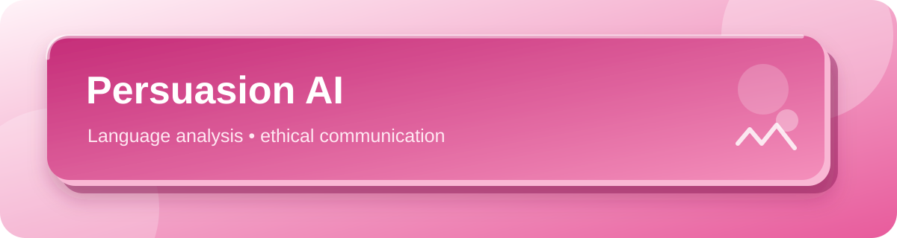

  
  

# Persuasion AI

An early project concept for analyzing persuasive techniques in text and supporting clearer, more transparent communication.

## Intended direction

The project brief proposes a workflow that could:

1. Identify persuasive techniques in a passage.
2. Explain how the language may influence a reader.
3. Summarize the strength and style of the message.
4. Suggest a rewrite that is clear and respectful.

## Responsible use

Any future version should make its analysis understandable, avoid deceptive or coercive targeting, and leave final communication choices with the person using it.

## Project status

This repository currently contains the project brief and this overview; source code and a runnable demo are not included.

---

More work: <a href="https://github.com/Anuuuuuuu18">github.com/Anuuuuuuu18</a> · Made with care in pink 🎀

